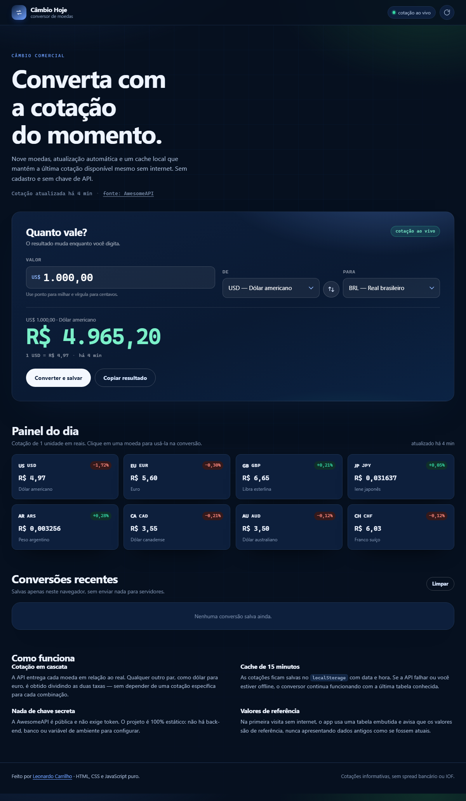

# Câmbio Hoje

[](https://github.com/LeonardoCarrilho/conversor-de-moedas/actions/workflows/ci.yml)
[](LICENSE)

Conversor de moedas com **cotação ao vivo**, cache offline e histórico local.
Feito com **HTML, CSS e JavaScript puro** e a API pública da
[AwesomeAPI](https://economia.awesomeapi.com.br) — sem chave, sem back-end e sem
dependências de produção.

**Demo:** https://leonardocarrilho.github.io/conversor-de-moedas/



## Funcionalidades

- Nove moedas: BRL, USD, EUR, GBP, JPY, ARS, CAD, AUD e CHF.
- Conversão em tempo real enquanto o valor é digitado.
- **Pares cruzados** calculados pela razão das taxas (USD → EUR, GBP → JPY etc.).
- Painel do dia com cotação de 1 unidade em reais, máxima, mínima e variação.
- **Cache de 15 minutos** no `localStorage`, com aviso explícito quando o valor
  exibido é cache ou tabela de referência — nunca um dado antigo disfarçado de
  cotação ao vivo.
- **Fallback offline** com a última tabela conhecida e botão de atualização manual.
- Histórico das últimas seis conversões, com ação de repetir.
- Botão para inverter as moedas e para copiar o resultado.
- Tema claro/escuro automático, atalhos de teclado e leitores de tela.

## Como funciona

A API devolve cada par já em relação ao real:

```json
{
  "USDBRL": { "bid": "4.9652", "pctChange": "-1.72", "timestamp": "1793019429" }
}
```

O app normaliza tudo para uma tabela **base BRL** (`BRL: 1, USD: 4.9652, …`) e
calcula qualquer par por regra de três:

```
1 USD → EUR  =  taxas.USD / taxas.EUR  =  4.9652 / 5.5973
```

Assim não é necessário consultar um endpoint diferente para cada combinação de
moedas, e qualquer moeda nova só precisa de uma linha em `src/rates.js`.

### Estratégia de cache

| Situação | O que aparece |
| --- | --- |
| API respondeu agora | “cotação ao vivo” |
| API falhou, cache com menos de 15 min | “última cotação salva” + aviso |
| Falhou e não há cache | “valores de referência” + aviso |
| Sem internet na primeira visita | tabela embutida datada, com aviso |

## Rodar localmente

```bash
git clone https://github.com/LeonardoCarrilho/conversor-de-moedas.git
cd conversor-de-moedas
npm start
# http://localhost:4174
```

Não há dependências de produção. O `scripts/serve.js` é um servidor estático de
desenvolvimento escrito apenas com módulos nativos do Node.

## Testes

```bash
npm test
```

Os testes (`node:test`) cobrem a normalização da resposta da API, descarte de
pares inválidos, taxa direta/inversa/cruzada, conversão, formatação de moeda e
percentual, idade relativa da cotação, validade do cache e disponibilidade das
moedas.

## Estrutura

```
.
├── index.html             # interface semântica
├── styles.css             # tema claro/escuro, grid e estados de foco
├── src/
│   ├── rates.js           # normalização, taxas cruzadas, cache e formatadores
│   └── app.js             # selects, máscara, painel, histórico e fetch
├── test/rates.test.js
├── scripts/serve.js
└── .github/workflows/ci.yml
```

## Decisões de projeto

- **Tudo em centavos na digitação:** a máscara trabalha com inteiros, evitando
  `0,1 + 0,2` no valor informado.
- **Cotação com data e hora:** o horário exibido vem do `timestamp` da própria
  API, não do momento em que a requisição foi feita.
- **Falha silenciosa não:** qualquer indisponibilidade vira um aviso visível e
  um estado próprio no cabeçalho.
- **Sem build:** o projeto abre com duplo clique (via servidor estático) e pode
  ser publicado em qualquer host de arquivos, inclusive GitHub Pages.

## Limitações

As cotações são informativas e não incluem spread bancário, tarifas, IOF ou
horário de fechamento do mercado. Para operações financeiras, consulte a
instituição responsável.

## Stack

HTML5 · CSS moderno · JavaScript ES Modules · Fetch API · `localStorage` ·
`node:test` · AwesomeAPI.

## Licença

[MIT](LICENSE) © Leonardo Fernandes Carrilho

## Contribuição e segurança

Leia [AGENTS.md](AGENTS.md) antes de alterar o projeto. Toda tarefa exige issue e PR associado, com validação antes da publicação.

Configuração de produção, observabilidade e limites da hospedagem: [docs/SECURITY.md](docs/SECURITY.md).
